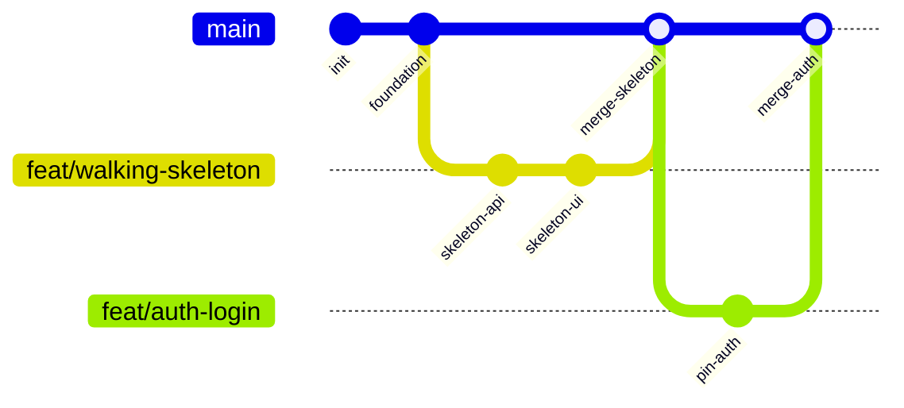

# StockMate Git Flow & Branching Strategy

> **Core Principle:** `main` is always deployable and production-ready. All changes pass through short-lived branches and pull requests verified by automated CI checks.

---

## 1. Branching Model (GitHub Flow)

### Branch Naming Conventions
- `feat/slice-<number>-<short-description>`: For vertical feature slices (e.g., `feat/slice-1-skeleton`, `feat/slice-2-catalog`).
- `fix/<issue-description>`: For bug fixes (e.g., `fix/checkout-debounce`).
- `docs/<doc-topic>`: For design packs, ADRs, and documentation.
- `chore/<task>`: For tooling, dependency bumps, or pipeline maintenance.

---

## 2. Commit Message Standard (Conventional Commits)

Format: `<type>(<optional-scope>): <subject>`

- `feat:` A new feature or capability.
- `fix:` A bug fix.
- `test:` Adding or updating automated tests.
- `docs:` Changes to documentation or ADRs.
- `refactor:` Code refactoring with zero functional change.
- `build:` Build system, CI pipeline, or dependency changes.

*Example:* `feat(sales): implement atomic conditional stock decrement on checkout`

---

## 3. Pull Request & Merge Rules

1. **Short-Lived Branches:** Branches should live for 1 to 2 days maximum and contain $\le 400$ lines of code diff.
2. **Automated Quality Gates:** A PR cannot be merged until all CI checks pass:
   - `npm run typecheck` (0 TypeScript errors)
   - `npm run lint` (0 ESLint errors)
   - `npm test` (100% test pass rate)
   - `npm run format:check` (Prettier compliant)
3. **Merge Strategy:** **Squash and Merge**. Keeps the `main` git history linear, concise, and professional for GitHub portfolio review.
4. **Protected Main Rules (GitHub Settings):**
   - Direct pushes to `main` are disabled.
   - Force pushes are blocked.
   - Status checks must pass before merge.
