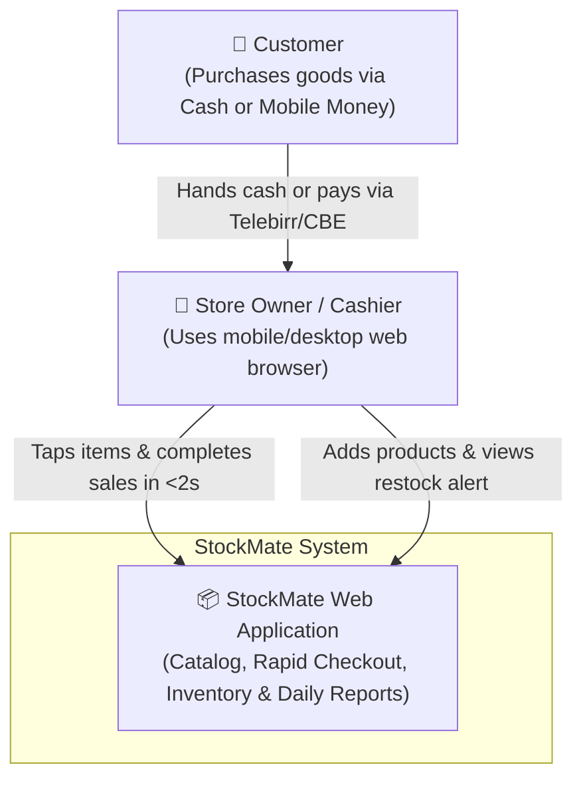
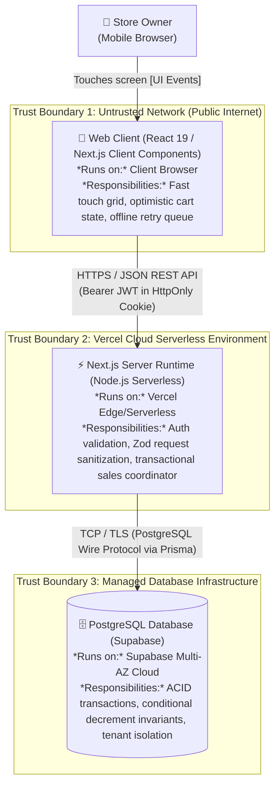

# D2. Shape: The Big Parts

> **Purpose:** Choose the architectural style that satisfies our drivers at lowest complexity, and map the containers, trust boundaries, and failure stories.

---

### 1. Architectural Style Selection

We evaluate candidate styles against our D1 drivers (1 developer, \$0 budget, peak 20 req/sec at 10× scale, $\le 300\text{ ms}$ latency):

| Style | Evaluation against StockMate Drivers | Verdict |
| :--- | :--- | :---: |
| **Modular Monolith** *(Default)* | **Perfect fit.** Single codebase, unified TypeScript types across client & server, zero inter-service network latency, zero-maintenance single deploy to Vercel. | **CHOSEN** |
| **Monolith + Worker** | Overkill for v1. We have no long-running CPU background tasks (no video transcoding, no bulk emails). | Reject |
| **Microservices** | Massive operational overhead ("microservice premium"), multi-network hops violate our 300ms checkout SLA, requires separate repos and databases. | Reject |
| **Queues & Event-Driven** | Adds message broker cost and asynchronous eventual consistency; our rush-hour checkout demands immediate atomic stock decrement. | Reject |

---

### 2. Picture 1: System Context Diagram (C4 Level 1)

---

### 3. Picture 2: Container Diagram (C4 Level 2)

---

### 4. Trust Boundaries

- **TB1 (Public Client $\rightarrow$ API Server):**
  - Data crossing this line is completely **untrusted**.
  - *Protection:* HTTPS/TLS, JWT signature verification in HttpOnly/SameSite cookies, strict Zod schema validation on every request payload, rate limiting.
- **TB2 (API Server $\rightarrow$ PostgreSQL):**
  - *Protection:* Authenticated TLS connection string, connection pooling, tenant scoping (`store_id = session.store_id`) enforced on every database query.

---

### 5. Arrow Protocol & Failure Stories

| From $\rightarrow$ To | Protocol | Primary Action | What if it is Slow, Down, or Fails? (Failure Story) |
| :--- | :--- | :--- | :--- |
| **Merchant $\rightarrow$ Web Client** | Browser Touch Events | Tap item tile / Tap Cash button | **Rapid double-tap or lag:** CSS `touch-action: manipulation` suppresses double-tap zoom; button debounces for $200\text{ ms}$ preventing duplicate triggers. |
| **Web Client $\rightarrow$ API Server** | HTTPS / JSON | `POST /api/sales` (Record checkout) | **Mobile network drops:** UI updates optimistically; client queues request in-memory with a client-generated UUID `idempotency_key`. Retries automatically when connection restores. If server returns 5xx, a persistent retry toast alerts the user. |
| **API Server $\rightarrow$ Database** | TLS / PostgreSQL Wire | `BEGIN ... COMMIT` (Prisma transaction) | **DB connection timeout or lock contention:** Server rolls back transaction cleanly, returns HTTP 409 (Conflict) or 503 (Unavailable). Zero partial writes, zero orphaned sale items. |
