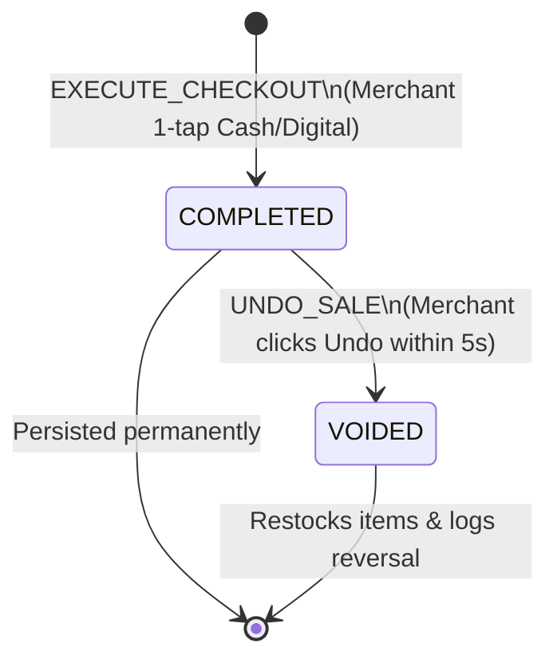
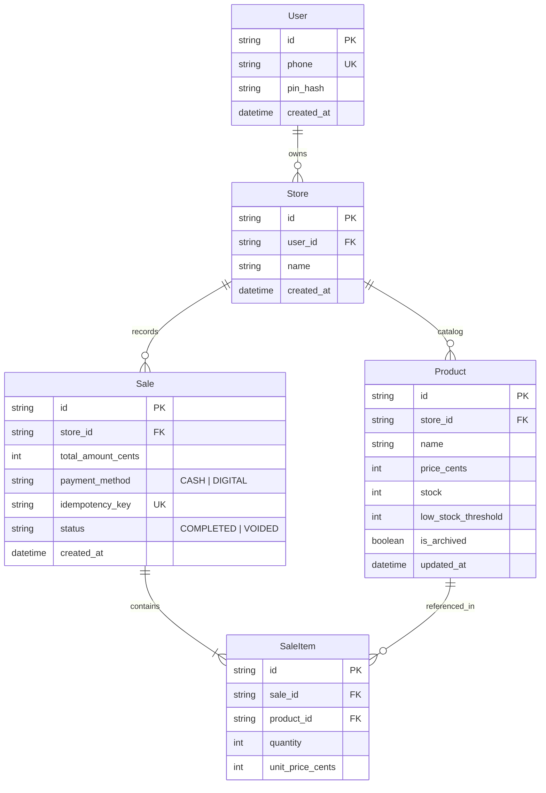

# D4. Data & Invariants

> **Order of Design:** State machines first (defining valid transitions), invariants second (rules enforced at the strongest layer), followed by ER models, concurrency, and time/money handling.

---

### 1. State Machines (States First)

#### A. Sale Lifecycle


| Current State | Event | Next State | Triggered By | Invariant & Side Effect | Safe to Repeat? |
| :--- | :--- | :--- | :--- | :--- | :---: |
| *(None)* | `EXECUTE_CHECKOUT` | `COMPLETED` | Merchant tap | Stock decremented atomically; sale record persisted. | Yes (Guarded by `idempotency_key`). |
| `COMPLETED` | `UNDO_SALE` | `VOIDED` | Merchant tap | Only allowed within 5 seconds; re-increments stock. | Yes (Idempotent void). |
| `VOIDED` | Any | — | — | **Terminal state.** No further transitions allowed. | No |

#### B. Product Stock Health
- **`HEALTHY`**: `stock > low_stock_threshold` (Standard tile UI).
- **`LOW_STOCK`**: `0 < stock <= low_stock_threshold` (Amber badge: *"Low: X left"*).
- **`OUT_OF_STOCK`**: `stock == 0` (Red badge: *"Out of Stock"*; checkout disabled).

---

### 2. Invariants Table (Rules Second)

Enforced at the **strongest layer possible** (Database constraint $\rightarrow$ Transaction $\rightarrow$ Code $\rightarrow$ UI):

| # | Business Invariant | Where Enforced | Enforcement Mechanism | Verification Test |
| :-: | :--- | :--- | :--- | :--- |
| **I1** | `Product.stock >= 0` (No negative stock) | **Database Layer** | SQL `CHECK (stock >= 0)` + Atomic `WHERE stock >= qty` | Concurrent checkout spike (Spike 2). |
| **I2** | Sale total equals sum of line items | **Transaction Layer** | Code asserts `total == sum(unit_price * qty)` before insert | Unit test with mismatching amounts. |
| **I3** | Zero duplicate checkout on double-tap | **Database Layer** | Unique index on `(store_id, idempotency_key)` | Automated replay test with same UUID. |
| **I4** | Past sale prices never change | **Database Schema** | `sale_items.unit_price` stores a frozen snapshot of unit price | Product price edit does not alter historical sales. |
| **I5** | Tenant isolation (Store A $\ne$ Store B) | **ORM / Query Layer**| Enforce `WHERE store_id = session.store_id` on every query | Cross-tenant API test with forged IDs. |
| **I6** | Integer currency precision | **Database Schema** | Stored as `Int` (cents/centesimi, 1 ETB = 100) | Zero floating-point drift test. |

---

### 3. Entities & Relationships (ER Model)



---

### 4. Source of Truth vs. Derived Data

| Fact | Single Source of Truth | Derived Copy / Calculation | Reconciliation Rule |
| :--- | :--- | :--- | :--- |
| **Current Stock** | `Product.stock` | Counter badge display | Derived on client; updated via optimistic decrements. |
| **Historic Sale Price** | `SaleItem.unit_price_cents` | None (Permanent fact) | Once written, immutable. |
| **Daily Sales Total** | Sum of `Sale.total_amount_cents` | Day closing report | Dynamically aggregated via indexed date query; never stored in a separate counter table that could drift. |

---

### 5. Concurrency & Consistency Boundaries

1. **Checkout Consistency Boundary (Single Short Transaction):**
   ```sql
   BEGIN IMMEDIATE;
   -- 1. Deduct stock atomically with guard
   UPDATE products 
   SET stock = stock - 1, updated_at = NOW() 
   WHERE id = $productId AND store_id = $storeId AND stock >= 1;
   -- (If rows_affected == 0, ROLLBACK and throw InsufficientStock)

   -- 2. Insert Sale record
   INSERT INTO sales (id, store_id, total_amount_cents, payment_method, idempotency_key, status)
   VALUES ($id, $storeId, $total, $method, $key, 'COMPLETED');

   -- 3. Insert Sale Items
   INSERT INTO sale_items (id, sale_id, product_id, quantity, unit_price_cents)
   VALUES ($itemId, $id, $productId, 1, $price);
   COMMIT;
   ```
2. **Outside Calls Rule:** Zero external API calls are made inside this transaction. Total execution duration is $<2\text{ ms}$.

---

### 6. Time and Money Standards

- **Money Rule:** All monetary values (`price_cents`, `total_amount_cents`, `unit_price_cents`) are strictly stored as **integers** in the smallest currency unit ($1\text{ ETB} = 100\text{ cents}$). Floating-point `Float` / `Double` types are strictly prohibited.
- **Time Rule:** All timestamps are stored in UTC (`timestamptz`). The UI renders dates in local East Africa Time (EAT, UTC+3).
